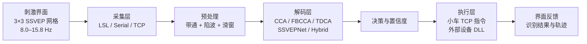

<div align="center">

# bci-visual-app

**Steady-state visual evoked potentials, decoded in real time, driving a physical car and a multi-paradigm interaction console.**

SSVEP 脑控交互系统：9 目标闪烁界面 + 多解码器在线识别，输出直连小车与外部设备。

[](#快速开始--quick-start)
[](#)
[](#解码器--decoders)
[](#)

</div>

---

## 项目简介 / Overview

SSVEP 是信噪比最高、最易落地的非侵入式 BCI 范式：用户注视不同频率闪烁的目标，枕区 EEG 会在对应频率及其谐波上出现稳态响应。系统的全部工作就是**在最短时间里把这个频率判对**。

本项目提供一套完整的在线链路：

- **刺激呈现**：3×3 网格，9 个目标，频率 8.0–15.8 Hz 连续分布，支持 block 内注视点控制；
- **信号采集**：LSL / NeuroDance 串口 / NeuroDance TCP 三种设备接入；
- **实时解码**：多种 SSVEP 算法并行可切换，滑动窗口输出目标编号；
- **动作执行**：识别结果经 TCP 下发给小车，或映射为外部设备指令。

> 界面、采集、解码、执行四层解耦——换解码器不需要改界面，换设备不需要改算法。

---

## 解码器 / Decoders

`models/` 下按算法族组织，可在配置中切换：

| 解码器 | 类型 | 适用场景 |
|---|---|---|
| `CCA` | 无训练 | 标准频率 + 正弦参考信号，零校准基线 |
| `FBCCA` | 无训练 | 滤波器组 + 谐波加权，低信噪比下优于单频 CCA |
| `TDCA` | 有训练 | 任务判别成分分析，利用训练试次学空间滤波 |
| `OptimizedTDCA` | 有训练 | TDCA 的集成/参数优化版本 |
| `SSVEPNet` | 深度 | 端到端时频特征学习 |
| `HybridDecoder` | 混合 | 多解码器决策融合 |
| `SpatialDecoder` | 空间滤波 | 通道加权与空间模式提取 |

无训练方法适合**即插即用**演示，有训练方法适合固定被试的**比赛场景**——两者的评估必须分开报告，否则校准成本被隐藏。

---

## 系统结构 / Architecture



| 层 | 目录 | 职责 |
|---|---|---|
| 界面 | `interface/car_interface` `interface/home_interface` `interface/deviceControl_interface` | 刺激渲染、参数面板、设备控制、训练框架 |
| 控制 | `controller/` | 识别调度、参数管理、人脸/注视检测 |
| 算法 | `models/` | SSVEP 解码器与深度学习模型 |
| 评估 | `evaluation/` | 离线与在线评估脚本 |
| 设备 | `source/` | 设备协议库（`LinkMe.dll`）、图标、QSS 主题 |
| 配置 | `config.yaml` `config/configer.py` | 被试、频率表、网格布局、设备类型 |

### 采集与执行

- `device_type` 支持 `lsl` / `neuro_dance_serial` / `neuro_dance_tcp`；
- 小车通过 TCP socket 接收目标指令（`car_window_v2.py`）；
- 外部设备数据解析依赖 `source/device/LinkMe.dll`（Windows）。

---

## 快速开始 / Quick Start

```bash
pip install -r requirements.clean.txt      # 精简依赖（推荐）
python main.py                             # 启动主界面
```

`requirements.local.txt` 为带版本锁定的本机环境；`requirements.txt` 为完整依赖。

### 配置

`config.yaml` 控制实验参数，主要字段：

```yaml
subjectName: hc33
sti_lst: [8.0, 9.0, 10.0, 11.0, 12.0, 13.0, 14.0, 15.0, 15.8]   # 9 目标频率
ssvep_grid_rows: 3
ssvep_grid_cols: 3
ssvep_fixations_per_block: 1
device_type: neuro_dance_tcp     # lsl | neuro_dance_serial | neuro_dance_tcp
```

### 人脸关键点模型（可选）

`controller/faceDetect_controller.py` 需要 dlib 的 68 点模型 `shape_predictor_68_face_landmarks.dat`。该文件体积较大且受许可限制，**不随仓库分发**，需自行下载后放到项目根目录；不启用注视检测功能时无需该文件。

---

## 评估 / Evaluation

`evaluation/` 提供离线与在线两套脚本：

- **离线**：固定试次集的分类准确率与信息传输率（ITR）；
- **在线**：真实闭环下的识别延迟、指令正确率与误触发率。

报告时需同时给出**准确率—时间曲线**：SSVEP 的准确率强依赖窗口长度，只报单一准确率会掩盖响应速度差异。

---

## 目录结构 / Layout

```
bci-visual-app/
├── main.py                 # 入口（PyQt5 + qfluentwidgets）
├── config.yaml             # 被试与范式配置
├── interface/              # 刺激界面、控制台、设备控制、训练框架
├── controller/             # 识别调度、参数、人脸检测
├── models/                 # CCA / FBCCA / TDCA / SSVEPNet / Hybrid
├── evaluation/             # 离线与在线评估
├── source/                 # 设备库、图标、QSS 主题
├── utils/                  # 日志与通用工具
└── saveCarData/            # 运行期数据输出（不入库）
```

## 在项目群中的位置

SSVEP 相关的离线解码基准（CCA/FBCCA/TRCA/TDCA 的统一实现与对比）在 [bci-bench](https://github.com/periodgod/bci-bench) 的 `ssvep` 模块中；本仓库聚焦在线系统与界面。同源实时系统见 [bci-arm-robot](https://github.com/periodgod/bci-arm-robot)（运动想象机械臂）。

---

<div align="center"><sub>World Robot Contest · BCI Event　|　采集数据与刺激素材不随仓库分发</sub></div>
